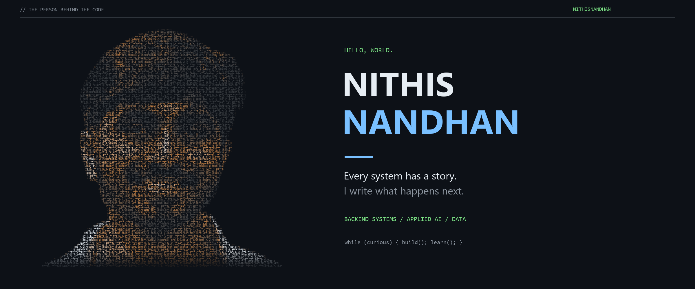

  

  <strong>Backend systems · Applied AI · Data</strong>

  <a href="https://www.linkedin.com/in/nithis-nandhan-e-70400930a/">LinkedIn</a> &nbsp; / &nbsp;
  <a href="https://github.com/NithisNandhan?tab=repositories">Explore my repositories</a>

### Hey, I'm Nithis 👋

I’m a student who likes getting past “it works” and understanding what makes it work.

My projects take me from backend APIs and local AI agents to distributed compilation and data dashboards. I enjoy the parts where different pieces have to fit together: an agent finding the right database context, a build engine deciding what can run in parallel, or a dashboard making a dataset easier to explore.

### A few things I've been building

| Project | What you'll find |
| :--- | :--- |
| **[Distributed Compilation & Cache Engine](https://github.com/NithisNandhan/Distributed-Compilation-and-Cache-Engine)** | A Go project exploring dependency-aware compilation, gRPC workers, and content-addressed caching. **Go · gRPC** |
| **[EMR AI Agent](https://github.com/NithisNandhan/EMR-AI-Agent)** | An agent project combining natural-language questions, database schema retrieval, and SQL tools across PostgreSQL databases. **Python · PostgreSQL · ChromaDB** |
| **[Grocery Sales Dashboard](https://github.com/NithisNandhan/PowerBI-Grocery-Sales-Dashboard-)** | A Power BI project with report definitions, a dashboard preview, and an exported report to explore. **Power BI · DAX · Power Query** |
| **[SPORTEdu](https://github.com/NithisNandhan/SPORTEdu)** | A sports education frontend with training content and interactive pages. **React · JavaScript · CSS** |

### Tools I've used along the way

**Languages:** Python, Go, JavaScript, SQL  
**Backend & AI:** FastAPI, PostgreSQL, gRPC, ChromaDB  
**Interfaces & data:** React, Power BI, dbt

### What keeps me curious

- How systems divide work and avoid doing the same work twice.
- How AI tools find useful context and interact with structured data.
- How to make a project understandable to the next person opening it.

You can also explore my **[FastAPI CRUD practice](https://github.com/NithisNandhan/FastAPI-CRUD-)** and **[dbt learning project](https://github.com/NithisNandhan/dbtCloud)**.

---

<em>Build something. Ask better questions. Keep improving it.</em>

